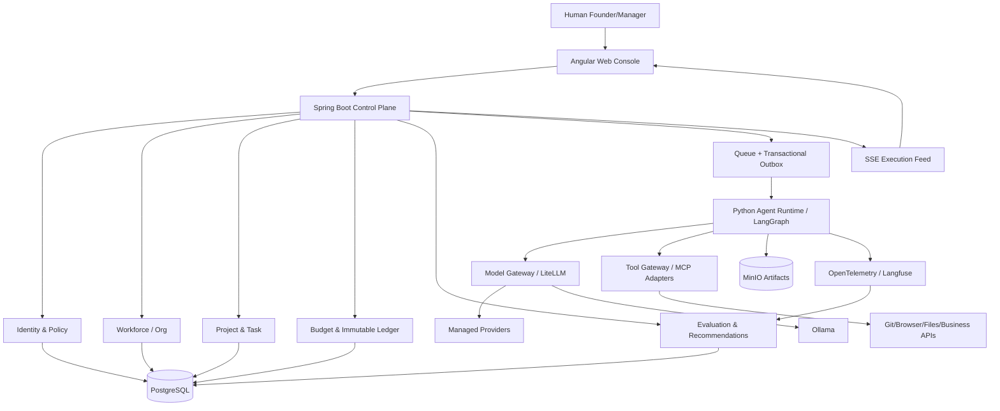
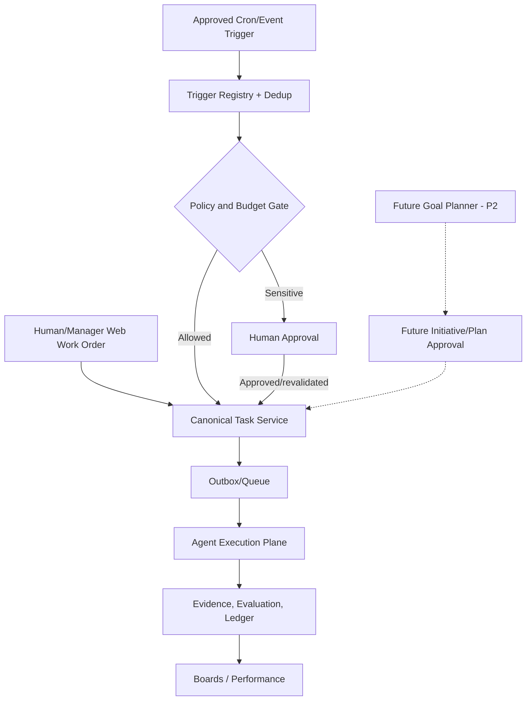
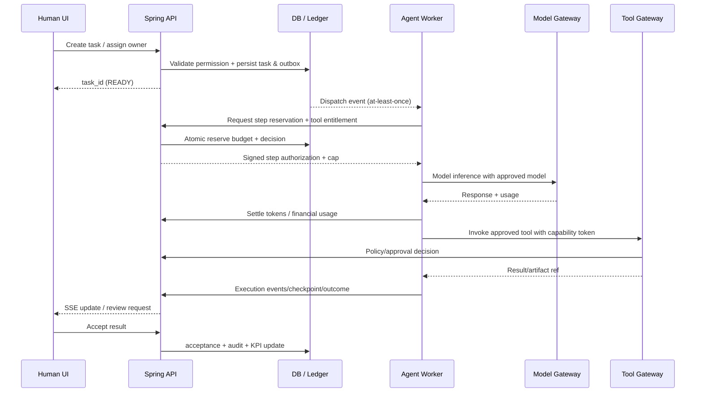

# Solution architecture — AI Business OS

## 1. Architectural drivers
- Single organization initially; modular and tenant-aware schema, no premature SaaS complexity.
- Web console first: transactional business actions, live status, org tree/board drill-down.
- Strong guarantees for authorization and budget; AI reasoning and orchestration remain pluggable.
- Distinguish control-plane truth from execution-plane eventually consistent observations.

## 2. High-level C4-style container diagram

### V1.1 extensions — task origin, proactive work and goal boundaries

- Create `TaskSource` and event `provenance` on canonical work items, not a separate second task engine.
- Trigger evaluation is a control-plane decision; queue workers cannot generate unlimited recurring work without an approved trigger policy.
- Keep `Proposal` vs `Approval` vs `Apply` distinct; revalidate authorization/budget at apply to prevent stale grants.
- Introduce a memory service/namespace policy boundary; retrieval content is untrusted, includes source/trust score/TTL, no implicit rights from LLM text.
- Goal-driven future modules (Goal Registry/Goal Planner/Initiative Evaluator) integrate via existing Work API and do **not** bypass budget/tool control planes.

## 3. Responsibilities
**Angular:** UI state, filters, interactive graph/board, authoring/approval, chart drill-down. Never owns authorization logic, financial truth, secrets.
**Spring Boot:** org/project/task CRUD, authorization policies, budgets/reservations/ledger, approval state, event outbox, KPI aggregate queries, audit.
**Python worker:** manages task run graph, step checkpoint, model/tool calls; consumes commands and emits events; cannot bypass budget/tool policy.
**Model Gateway:** normalized API/tool-calling support and provider retry/routing, usage telemetry; DB-backed LiteLLM optional; **not** source-of-truth for business budget.
**Tool Gateway:** validates tool signatures/schema, enforces grant & approval, retrieves credentials from secret store, sandboxes execution, captures artifact and tool-result metadata.
**Observability:** telemetry pipeline correlates org, project, task, owner, actor, run, model, tool, charge_id across systems.

## 4. Recommended deployment path
**MVP Compose:** reverse proxy -> angular static app, Spring Boot API, Python worker, Postgres, Redis/RabbitMQ, LiteLLM (with its configured DB), MinIO, optionally Langfuse + tracing backend. External MCP connectors sandboxed/controlled. No inbound public tool port unless required. Secret encryption/credentials store not plain env checked into code.
**Kubernetes migration:** independent Deployments/HPA; message queue & DB remain stable contracts; named secret service; per-run isolation via Jobs or sandbox runtime; resource quotas, network policies, canary/rollback.

## 5. Work execution sequence

**Warning:** practical cost reservation for external providers cannot fully guarantee external billing if provider ignores timeout or reports delayed usage. Enforce estimates/max-output caps, bounded overrun reserves and reconciliation/alerts; acknowledge this residual risk in production controls.

## 6. Durability and consistency rules
- Domain writes in single Postgres transaction with outbox record.
- Broker at-least-once. Consumer `(event_id, handler)` inbox dedup.
- Execution checkpoint includes step version, pending approval, replay strategy; side-effecting tool requires external idempotency token or compensating/reconciliation workflow.
- Financial reserve/settle transaction locks necessary budget rows (stable sorted lock ordering) and is retry-safe by unique step_charge_key.
- End-user dashboards via read models, projections, and SSE; ledger is authoritative, analytical aggregation may lag briefly and shows last-updated.

## 7. Key ADRs
- ADR-001: Control-plane in Java, execution-plane Python; contract via HTTP/events. Reason: Java transactional expertise + Python AI ecosystem.
- ADR-002: Start modular monolith in Spring Boot; separate Python worker and gateways. Reason: fewer cross-service transaction pitfalls at 1..N employees.
- ADR-003: Org hierarchy is tree; project/team collaboration graph separate. Reason: simple chain of command with flexible projects.
- ADR-004: Enterprise UI uses server-query scoped aggregates; frontend does not compute global KPI from partial current page.
- ADR-005: Money ledger internal rather than delegating all guarantees to model proxy; user-scoped proxy budget is auxiliary.
- ADR-006: Generic skills/MCP model does not bind product to a domain-specific workflow framework.

## 8. Hardening and scale thresholds
- If task queue > configured lag or P95 board latency > SLO, scale read-model, workers, queue partitions independently.
- Stream detailed traces as paged/cursor artifacts; do not put giant tool outputs or secrets into Postgres/task row.
- Use scoped pagination and targeted database indexes for 10k+ tasks; build materialized/projected views when needed.
- Separate API admin credentials from runtime non-admin service identities.
