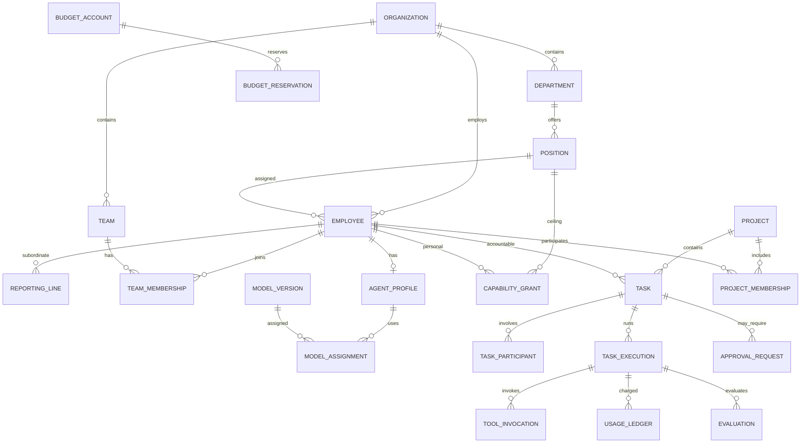
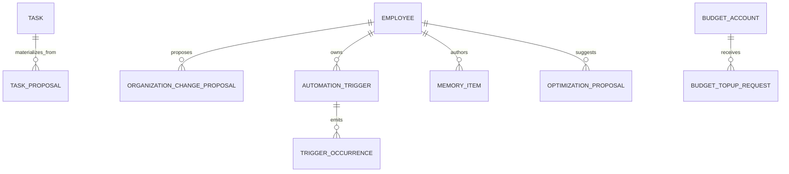

# Data model / ERD specification

## 1. Logical ERD

## 1.1 V1.1 scope additions

- Task adds `origin_type`, `origin_ref`, `initiated_by_employee_id`, `trigger_occurrence_id` nullable, with source integrity validated in application transaction.
- Trigger occurrence uniqueness `(trigger_id, occurrence_key)` prevents duplicated schedule/event-driven work. `AUTO_CREATE_IN_POLICY` requires a separate bounded policy gate.
- Memory item stores `scope_type`, `scope_id`, `classification`, `content_ref`, `provenance`, `status`, `version`, `expires_at`; do not store raw API secrets. Read ACL is verified per retrieval, not just on indexing.
- HR changes, top-ups, prompt/skill/model optimization are proposals with distinct human approval/apply lifecycle; independently audit the **effective** changes.
- Goal/initiative schema proposed for future migration only; do not prematurely activate future service or UI.

## 2. Organisational and work identity
- All table IDs use UUID; UTC timestamptz; revision number for optimistic concurrency.
- `employee` has kind HUMAN/AI; AI employee has `agent_profile` (1:1), HUMAN employee user principal optional.
- `reporting_line` effective_start, effective_end; no overlapping ACTIVE intervals for same subordinate. Manager edge cycle guarded in service transaction (not solvable by simple FK).
- `department` is primary home for employee; team is M:N and can be cross-department; project membership M:N. A department/team projection is computed from these relations, **not** separate duplicated task rows.
- `project` has accountable_owner, status, due_at; joins to involved teams/departments via membership tables.
- `task` has nullable primary_project_id, accountable_owner_employee_id, type, priority, due_at, acceptance criteria, status, task_parent_id nullable, complexity/risk flag, version.
- `task_participant` grants COLLABORATOR/REVIEWER/EXECUTOR; any change to task ownership is audited.

## 3. Scoped board filtering and KPI semantics
One canonical query pipeline:
1. Authenticate actor, resolve view scope and authorization to obtain visible **distinct task IDs**.
2. Apply filters: `company | department | team | project | employee | reporting_subtree | role`, and date/status/priority/tags.
3. Gather task status snapshots, authoritative run/ledger facts, acceptance and current assignment.
4. Group by status/person/project/owner; count distinct tasks; cost sums charge records once (unique ledger key).
5. Project dashboards use project attribution; employee dashboards use performer/owner separately, clearly labeled. Cross-scope cards never add together overlapping subgroup summaries.

Define time-based metrics: **WIP** = distinct tasks IN_PROGRESS; **Done** = COMPLETED, **Accepted** = ACCEPTED; throughput = accepted in window; overdue = due_at passed AND not accepted/cancelled; backlog aging = days since READY; completion lead time = accepted_at - created_at. KPI reset and timezone rules versioned.

## 4. Ledger and attribution
`usage_ledger`: one immutable charge or reversal record per provider-reported usage/tool execution, unique `(execution_id, charge_reference, entry_type)`; stores input, output, cache reads/writes, token total, currency, cost, price snapshot, provider request id, task id, primary project id, executor id, organization id. Corrections append reversing events.

`budget_account` applies *multiple simultaneous caps* to matching cost object. For a run, constraint checks cover company, relevant department, team (according to allocation policy), employee, project, task and execution. These are overlays, **not separate expense postings**. `budget_reservation` locks and reserves estimated max costs/token by unique `step_key`; on settle releases unused reserve and appends actual charge. Task attribution chooses one billable project (nullable) and one cost-center to avoid duplicate financial expense even if 2 teams participate.

## 5. Model and tool registry
- Provider: credential_ref to secret store, endpoint alias, health state, supported region, data policy.
- ModelVersion: provider+model_id+revision/effective_date, capability flags, context_window, price snapshot, performance eligibility.
- ModelAssignment: employee, model_version, generation params, effective times, approval id, fallback pool.
- MCPCatalogServer: endpoint/transport/schema-fingerprint, approval status, security class.
- ToolDefinition: tool_id, mcp_server, version, JSON schema, risk tier, side-effect flags, scopes.
- SkillDefinition: name, version, source hash, instructions, required tool identifiers (dependencies, not entitlements).
- CapabilityGrant: subject `POSITION|EMPLOYEE|TASK|ROLE`, target `SERVER|TOOL|SKILL`, access, conditions, expiry, approval_id.
- ToolInvocation: execution, tool, arguments sanitized/encrypted ref, authorization decision, approval, output artifact ref, attempt, idempotency key, measured cost.

## 6. Project and task details
Task dependency separate join `(source_task_id, target_task_id, type=FINISH_TO_START|BLOCKS)`; no cycles, validate before commit. Comments are append-only with redaction events. `work_view` is saved filter/layout, owner, sharing policy. `project_milestone` and `project_risk` are first-class for portfolio summary.

## 7. Physical design / indexes
- `tasks(org_id, status, due_at)`; `tasks(project_id, status, updated_at)`; `tasks(owner_employee_id, status, updated_at)`.
- `team_membership(team_id, employee_id)` and `project_membership(project_id, employee_id)`.
- `executions(task_id, started_at desc)`; `ledger(org_id, posted_at)` and `(task_id, posted_at)`, `(model_version_id, posted_at)`.
- Use cursor pagination. Optional read-model denormalization/projected indexes when measured P95 breaches objective.
- Partition ledger or execution_events by time only after volume observed, avoiding premature DDL complexity.

## 8. Detailed contracts
See `schema-starter.sql` for subset of safe baseline constraints; API actions in `openapi-starter.yaml`. Neither file claims to be exhaustive or production ready.
